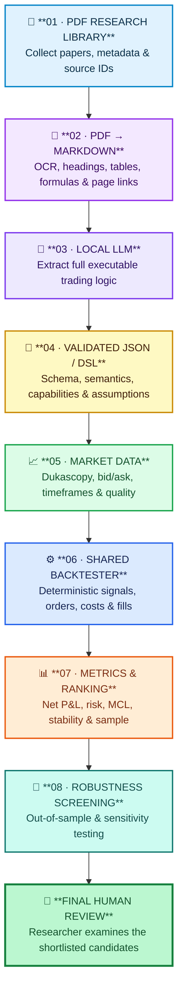

<div align="center">

# 🔬 Automated Trading Strategy Discovery

### From Research Papers to Evidence-Ranked Trading Candidates

**A reusable, traceable, and reproducible research architecture**


**[🎨 Explore the original tldraw architecture](https://www.tldraw.com/f/c7ZOGukmHlwJDdAcXYMLK)**

</div>

> [!IMPORTANT]
> **Primary goal:** Discover potentially profitable, rule-based trading strategies from academic and technical research papers. Automation is the method; **risk-adjusted profitability and robustness** are the research objectives—not guaranteed outcomes.

> [!NOTE]
> **Project status:** Proposed architecture and research design. Implementation has **not** started. This README mirrors the current tldraw board; items marked *Open* or *Proposed* are not finalized decisions.

> [!NOTE]
> **Current intraday research shortlist:** Start at [the final research directory](research/final_top10/README.md), then read its [ranking report](research/final_top10/ranking_report.md) and [ranking CSV](research/final_top10/top_10.csv). Earlier intraday v1/v2 research is preserved in `research/archive/intraday_pre_final_2026-11-01.tar.gz`; older broad-market files referenced by those notes were not present in this checkout. None of the ten final specifications has been backtested in this repository.

---

## 🧭 01 / The End-to-End Automated Pipeline

The system screens **1,000+ methods** without requiring manual approval of each extracted strategy. The researcher enters at the **final shortlist evaluation**.



### Pipeline stages and artifacts

| Stage | What happens | Main artifact |
| :-- | :-- | :-- |
| 📄 **01 — PDF Research Library** | Ingest papers and preserve their identities, bibliographic metadata and original files. | `source_pdf`, `paper_id`, metadata |
| 📝 **02 — PDF → Markdown Conversion** | Convert each `.pdf` into structured `.md`. Use OCR when necessary; preserve headings, tables, formulas, figure context, and links to source pages. | `normalized_paper.md`, conversion warnings |
| 🧠 **03 — Local LLM Extraction** | Extract market/timeframe, indicators, Boolean and temporal conditions, entries, exits, and risk logic. | `strategy_spec`, uncertainties |
| 🧩 **04 — JSON/DSL Validation** | Check schema, semantics, supported engine primitives, and provenance of assumptions or modifications. | `validation_result`, versioned variants |
| 📈 **05 — Market Data Preparation** | Initially use Dukascopy FX/CFD history; align timeframes, normalize bid/ask conventions, and detect gaps or timestamp problems. | `dataset_manifest`, cached history |
| ⚙️ **06 — Deterministic Backtest Engine** | Interpret the same rule language for many strategies; simulate signals, positions, order fills and relevant costs. | `trade_ledger`, `equity_curve`, event log |
| 📊 **07 — Metrics & Ranking** | Compute comparable net performance and risk metrics, then rank eligible methods. | `evaluation_report`, ranked results |
| 🧪 **08 — Robustness Screening** | Test candidates out of sample, across regimes and under different cost/parameter assumptions. | Tested candidates with caveats |
| 👤 **Final Human Review** | Examine the shortlist and select methods for further paper/forward testing. | Research decisions and next tests |

**Important boundary:** The first eight stages are designed for automatic, high-volume processing. The researcher is **not** required to validate every paper or every extraction during normal batch execution. Invalid, contradictory, unsupported or non-executable rules receive explicit statuses rather than fabricated results.

---

## ♻️ 02 / Architecture Principles

| ♻️ Reusable Engine | 🔎 Traceable Logic | 🔁 Reproducible Runs |
| :-- | :-- | :-- |
| **One interpreter, many papers.** Add a new DSL primitive once and reuse it for future strategies. | Connect rules to source passages. Label explicit, derived, assumed, modified and unresolved details. | The same strategy, data, cost settings, execution model and engine version should reproduce the same result. |

The initial implementation may be a **modular monolith**. Dedicated services should be introduced only when actual workload and operational requirements justify them (*proposed*).

---

## 🧠 03 / The Language Between AI and the Engine

The locally hosted LLM is a **translator**, not the executor of trades. It converts research-paper logic into a constrained **JSON representation of a domain-specific language (DSL)**. A deterministic backtester interprets that structure.

### A small visual example

| 🔵 Indicators | 🟡 Signal logic | 🟢 Orders + risk |
| :-- | :-- | :-- |
| `EMA(20)` and `EMA(50)`<br/>`RSI(14)` | `crosses_above(EMA20, EMA50)`<br/>**AND** `RSI < 40` | **LONG** on next eligible bar<br/>**SL:** 20 pips / **TP:** 40 pips |

*The example is synthetic and illustrates structure only; it is not attributed to a research paper or a finalized production schema.*

### Proposed DSL vocabulary

| Category | Typical primitives |
| :-- | :-- |
| **Values & indicators** | OHLC, bid/ask, EMA, SMA, RSI, ATR, custom registered indicators |
| **Boolean & comparisons** | `all`, `any`, `not`, `>`, `<`, `>=`, `<=`, `==` |
| **Temporal logic** | `previous`, `crosses_above`, `consecutive`, `within_last_n` |
| **Candle patterns** | Explicit engulfing and candle-body comparisons |
| **Trading rules** | Long/short signals, stops, targets, timeouts, sizing, position limits |
| **Market constraints** | Timezones, sessions, time windows, permitted markets and timeframes |

### 🧰 Feature / Operator Registry

- Each primitive has defined types, parameters, semantics and tests.
- Unknown indicators or operations yield an explicit **unsupported-feature** status.
- A missing feature can be implemented **once** in the shared engine and reused.
- Arbitrary LLM-generated Python is **not executed** in the backtester.

### Uncertainty and assumptions

When a paper is incomplete, a defensible default or modified version may be tested **if the deviation is recorded**. For example, using `RSI(14)` when the source does not specify a period is an *assumption*, not a faithful claim about the original paper. Every variant gets its own version and provenance.

**Unresolved essential logic**, missing required data, contradictory rules, or unsupported execution semantics must prevent an unsupported backtest from being presented as valid.

---

## ⚙️ 04 / Realistic Backtest Execution

| Control | What the engine must respect |
| :-- | :-- |
| 🕒 **No Look-Ahead** | Completed observations only; distinguish the observation, signal, order submission, and actual fill time. |
| 💱 **Bid / Ask + Costs** | Spread, commissions, slippage assumptions, financing, contract size, margin/leverage, and lot rounding when applicable. |
| 🛑 **Edge-Case Policies** | Same-candle stop and target, gaps, weekends, session close, overlapping signals, margin limits, and insufficient history. |
| 📅 **Data Quality** | Timezone/DST conversion, multi-timeframe alignment, duplicated/missing prices, unexpected jumps, and other anomalies. |

**Initial data source:** Dukascopy historical FX/CFD-style data. The data adapter is intentionally replaceable; the architecture is not permanently limited to this provider or market.

The source of truth for trades should be a deterministic bar/tick or event-processing core (*proposed*). Reproducibility requires fixed fill conventions, even when the source candles do not reveal the intrabar order of events.

---

## 🏆 05 / Evaluation & Risk-Adjusted Ranking

> **Promising ≠ simply the highest return.** A strategy should be judged on profitability **after costs**, risk, stability and the amount of supporting evidence.

| Metric | What it contributes |
| :-- | :-- |
| 💰 **Net P&L / Return** | Profit remaining after simulated trading costs. |
| 📉 **Maximum Drawdown** | Worst observed peak-to-trough equity loss; acceptable limit **TBD**. |
| 🔁 **Maximum Consecutive Losses (MCL)** | The longest losing streak. **A ranking factor, not an automatic rejection rule.** |
| 📊 **Win Rate / Profit Factor / Expectancy** | Outcome distribution and average expected result per trade. |
| 🧮 **Trade Count** | Whether the tested sample is substantial enough to interpret. |
| 🧭 **Performance Stability** | Whether returns persist across periods and conditions. |

### Proposed two-layer assessment

1. **Eligibility checks:** Reject or defer invalid, unsupported or insufficiently evidenced runs.
2. **Ranking score:** Compare eligible runs using a configurable combination of measured results.

The **composite formula, weights, minimum trade count and numerical risk thresholds are open decisions**. A second LLM/analysis agent may explain reports, but it should not arbitrarily rewrite deterministic criteria or certify future profitability.

---

## 🧪 06 / Scientific Validation & Robustness

| Research control | Purpose |
| :-- | :-- |
| 🧪 **Sampled Extraction Audit** | Manually annotate a diverse benchmark sample, compare it to the LLM's extraction and record error categories. Approximately **30 papers/methods** is an initial proposal, not a fixed sample size. |
| 🔐 **Untouched Out-of-Sample** | Evaluate finalists on data not used to tune or select them. Reusing the same holdout repeatedly weakens its independence. |
| 🔬 **Walk-Forward / Robustness** | Test across time/regimes and vary realistic trading costs, fill models and reasonable assumptions. |
| 📡 **Paper / Forward Testing** | Observe promising finalized rules using incoming data before considering any separate real-capital deployment. |

**Two proposed extraction-quality measurements** (still awaiting agreement):

- **Extraction fidelity:** How closely the extracted rules match the original paper.
- **Executable-variant quality:** Whether the supported rules and clearly recorded assumptions form a valid strategy specification.

Automating thousands of trials creates selection bias: an apparently excellent backtest may be found by chance. **Track all tested variants and failures**, not only winners.

---

## 🗂️ 07 / Experiment Memory & Audit Trail

Every run should preserve its inputs, versions, and results. An illustrative run manifest is:

```yaml
run_id: unique_run_identifier
paper_id: source_paper_identifier
strategy_spec: strategy_id_and_version
assumption_set_id: assumption_version
dataset_id: dataset_id_and_hash
date_range: tested_start_and_end
engine_version: exact_engine_version
execution_model_version: fill_model_version
cost_config: chosen_cost_scenario
screening_policy_version: ranking_policy_version
outputs:
  - complete_strategy_spec
  - trade_ledger
  - equity_curve
  - evaluation_report
  - warnings_and_screening_reasons
```

The platform must retain **failed, deferred and rejected** experiments as well as promising ones. This protects reproducibility and reveals the true size of the search effort.

---

## 📋 08 / Decision Register

### 🟢 Agreed / Confirmed

- **Primary aim:** Discover promising profitable methods using the paper-to-backtest automation pipeline.
- **Scale:** Process **1,000+ methods**, without mandatory human approval of every extraction.
- **Human-in-the-loop:** Review only the final shortlist during routine batch processing.
- **Conversion:** **PDF → Markdown** before the LLM, retaining source-page traceability.
- **Data:** Start with **Dukascopy** and **FX/CFD-style historical testing**.
- **Assumptions:** Label defaults, approximations and modifications explicitly.
- **Evaluation:** Risk-adjusted profitability; MCL contributes to ranking instead of acting as a hard exclusion.
- **Validation:** Use a manually reviewed benchmark sample to measure extraction quality.
- **Engineering goals:** Reusability, traceability and reproducibility.

### 🟡 Open / Proposed — Not Finalized

- Exact scoring formula, weights, MCL treatment details, drawdown threshold and minimum observations.
- Initial DSL operator coverage and specific handling for unresolved or unsupported paper logic.
- Order timing, same-bar fill rules, cost assumptions and broker/contract specifications.
- Historical date splits, holdout policy, walk-forward windows and robustness thresholds.
- Specific local LLM, OCR/parser stack, implementation language, persistence and deployment topology.
- Whether extraction fidelity and executable-variant quality become two distinct formal metrics.
- Paper-level and strategy-level classification properties (under discussion, not agreed).

---

<div align="center">

### 🔬 Research System — Not an Automated Live-Trading Bot

**A historically profitable backtest is a candidate for further investigation, not a guarantee of future performance.**

**[↗ View the editable tldraw board](https://www.tldraw.com/f/c7ZOGukmHlwJDdAcXYMLK)**

</div>
